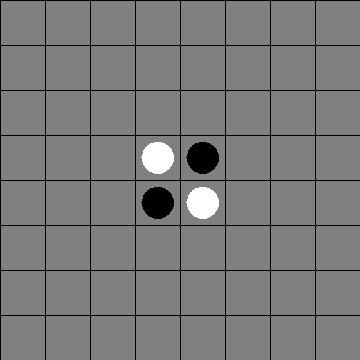
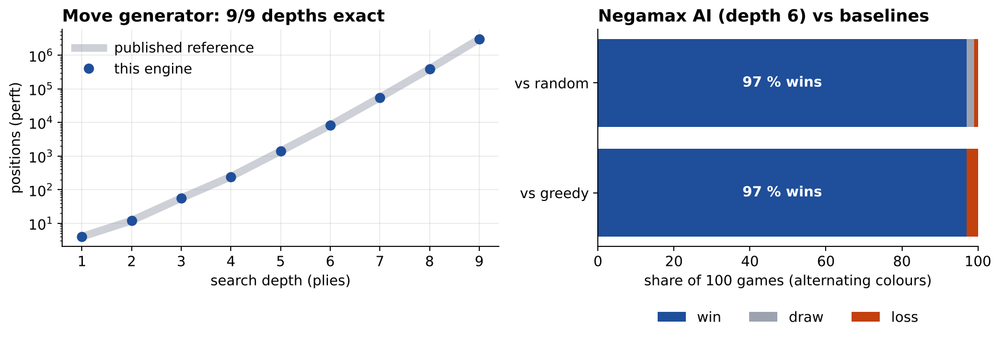

# Othello AI: Bitboard Engine with Negamax Search

An Othello (Reversi) engine and game AI written from scratch in Java. It was built in the **programming lab (Programmierpraktikum) of the Bioinformatics programme at LMU Munich & TUM**, winter semester 2025/26. Development, automated tests and grading took place on the **LMU GitLab** (`gitlab2.cip.ifi.lmu.de`), and this repository is the GitHub copy of that work.

<p align="center">
  
  <br><sub>A real game in the GUI: human (black) against the AI (white), recorded from the program's own window.</sub>
</p>

## Highlights

- **Bitboard engine.** The whole board is stored as two 64-bit integers, one per player. Move generation and disc flipping are done with bit shifts and masks in all 8 directions, so there are no loops over a 2D array.
- **Exactly correct move generation.** Perft (counting every legal move sequence) matches the published reference values at all depths 1–9, which means **3,005,288 positions at depth 9**, enumerated in under 0.3 s.
- **Negamax AI with alpha-beta pruning**, searching 6 plies ahead. Its evaluation combines disc difference, mobility and a positional weight table that values corners and penalises the squares next to them.
- **Strong results.** Over 100 games each (alternating colours), the AI won 97 against a random player and 97 against a greedy player that always flips the most discs. It needs about 40–65 ms per move.
- **Swing GUI** for playing against the AI.
- **Plug-in player.** The AI implements the course's `szte.mi.Player` interface, so it can be loaded as a jar and play against other AIs.



## How it works

### Board representation

```
bit index = 8·y + x        black: long playerBlackBoard
                           white: long playerWhiteBoard
 0  1  2  3  4  5  6  7
 8  9 10 11 12 13 14 15    shift N  = b << 8
 ...                        shift E  = (b & ~column H) << 1   (mask stops wrap-around)
56 57 58 59 60 61 62 63    shift NE = (b & ~column H) << 9  ...
```

**Legal moves for all squares at once:** for each direction, start from my discs, shift them onto adjacent opponent discs and keep extending the run. The empty square just past the end of a run is a legal move. ORing the 8 directions together gives all legal moves as one 64-bit mask (`getPossibleMoves`).

**Making a move:** walk from the new disc in each direction over opponent discs. If the walk ends on one of my own discs, the run gets flipped. A single XOR then updates both bitboards (`makeMove`). Disc counts come from `Long.bitCount`.

### Search

`AI.java` runs negamax with alpha-beta pruning to depth 6. It handles passes and stops when both players have to pass. Leaf positions are scored as

```
score = (my discs − opponent discs)
      + 5 · (my mobility − opponent mobility)
      + Σ positional weights   (corners +100, X-squares −50, C-squares −25, …)
```

Corners can never be flipped back, so the weight table makes the AI fight for them early and avoid the squares that would give them away.

## Repository structure

```
src/main/java/de/lmu/bio/ifi/
├── Othello.java        bitboard game model (move generation, flipping, game status)
├── AI.java             negamax + alpha-beta player (szte.mi.Player interface)
├── OthelloGUI.java     Swing GUI: play against the AI
└── OthelloRunner.java  console demo
src/test/               course test suite (model structure, rules, full game sequences)
bench/                  perft check + arena against baseline players, plot script
docs/                   GIF, screenshot, benchmark figure
```

The course template from LMU contained the `Game` interface, `GameStatus`, the `szte.mi` tournament interfaces and the test suite. The game model, AI, GUI and benchmarks were written by me.

## Run it

```bash
# play against the AI
javac -d out $(find src/main/java -name "*.java")
java -cp out de.lmu.bio.ifi.OthelloGUI

# reproduce the benchmark (perft up to depth 9, 100 games per opponent)
javac -d out $(find src/main/java bench -name "*.java")
java -cp out Benchmark 9 100 | tee bench/results.txt
python3 bench/plot_results.py

# course test suite
mvn test
```

## Timeline

| Date | Milestone |
|---|---|
| 31 Oct 2025 | Course template (LMU GitLab) |
| 14 Nov 2025 | Model submission: bitboard engine + negamax AI |
| 20 Nov 2025 | Final submission: cleaned-up engine, Swing GUI |

Before this project, the same course had me build a [TicTacToe warm-up](https://github.com/SiljaOh/tictactoe-java) (game model, JavaFX GUI).

## Author

**Silja Ohlsen**, B.Sc. Bioinformatics, TU Munich & LMU Munich
